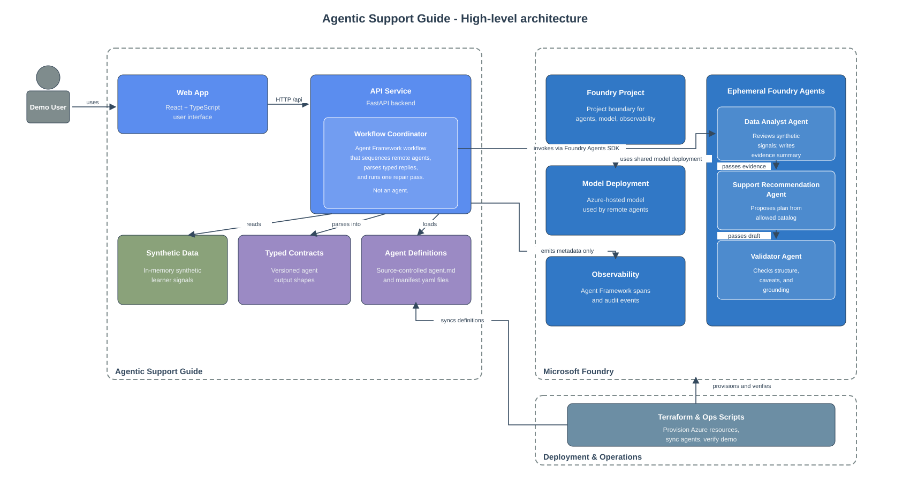

# agentic-support-guide

> **Start Here.** This is a local prototype. Every dealership shown on screen is
> synthetic. When it is connected to Microsoft Foundry, three collaborating
> agents run real language-model calls to produce a structured, validated
> support recommendation.

> **Prototype scope.** This prototype uses synthetic data. It is intended to
> demonstrate architecture and workflow patterns, not to make production
> pricing, financing, credit, compliance, safety, or staffing decisions.

> **Two tracks, one app.** The application is written twice, in Python and in
> .NET, and both behave the same: the same API, UI, agent definitions, Azure
> resources and results. The **Python** track lives under `python/` (FastAPI,
> Microsoft Agent Framework for Python); the **.NET** track lives under
> `dotnet/` (ASP.NET Core, Microsoft Agent Framework for .NET). The UI, the
> agent definitions, the evaluation cases and the docs are shared. Pick one —
> see [Choose a track](workshop/README.md#choose-a-track) — and follow it
> throughout: wherever a step below depends on the language, it is given for
> both.

## Start here (for teams new to this stack)

If you are new to agentic applications, Microsoft Foundry, DevOps, MLOps,
or GenAIOps, read these first — in order — before touching code:

1. [Getting started for new teams](docs/getting-started-for-new-teams.md)
   — concept-first tour of what an agent, a coordinator, and Microsoft
   Foundry are, and how this repo fits together.
2. [Architecture](docs/architecture.md) — pattern first, then this repo's
   implementation.
3. [Architecture diagram](docs/architecture-diagram.md) — the C4
   container view.
4. [GenAIOps](docs/genaiops.md), [Security and privacy](docs/security-and-privacy.md),
   [Observability](docs/observability.md) — concept-first, then repo.
5. [Agents vs. bigger prompts](docs/agents-vs-prompts.md) — the answer
   to *"why not just keep adding more context to the prompt?"*, anchored
   to this solution.
6. [Glossary](docs/glossary.md) — plain-language definitions of every
   term used above.

## Architecture diagram

<p align="center">
  
</p>

Editable source: [docs/architecture.dsl](docs/architecture.dsl). Regenerate the SVG with `.\maintenance\render-architecture-diagram.ps1` after changing the DSL.

More details: [docs/architecture-diagram.md](docs/architecture-diagram.md).

---

## What this app is (in plain language)

Imagine an admin console for someone who supports dealerships in a generic
dealership-style setting. The console has a Dashboard, an Assessments page,
a Supports plan builder, and an AI Audit trail.

When you use the Supports plan builder, you pick a dealership, pick a support
category, and describe a concern in a text box. The app then runs three
short model calls in sequence. Each call has a specific job. Together they
produce a structured recommendation that a human reviews and approves.

- **Data Analyst Agent** looks at the dealership's synthetic signals and writes
  a short evidence summary. It does not propose changes.
- **Support Recommendation Agent** reads that evidence and proposes a
  structured plan (support tier, frequency, grouping, goal
  candidates, strategies, next steps). It can only choose from an allowed
  catalog.
- **Validator Agent** checks structure, required caveats, and grounding.
  It uses deterministic rules in code, plus an advisory model critique.

Between those three agents sits a **deterministic coordinator** — a
Microsoft Agent Framework `WorkflowBuilder` graph inside the API service
(FastAPI in the Python track, ASP.NET Core in the .NET track). Six executors
and six edges order the calls, stop the run when an agent's reply does not
parse into its typed contract, and run at most one repair pass if the
validator rejects the draft. The coordinator is **not** a fourth agent; it
does not talk to a language model.

This is a **Microsoft Agent Framework** workflow, not an imitation of one:
specialized agents exchanging typed messages across a graph of executors
and conditional edges, with structured output, deterministic validation,
and metadata-only auditing.

The three agents run on **Microsoft Foundry** through Microsoft Agent
Framework, and the same definitions are published to Foundry as **prompt
agents** so they are visible and versioned in the portal. Foundry owns the
model deployment, provides keyless Entra ID authentication, and is the
organizational unit for agents, evaluation, and safety workflows.

## What is synthetic vs. real

- Every dealership, region, segment, KPI, and trend value in the UI is
  **synthetic**, generated by deterministic factories seeded with a fixed
  constant. Nothing on screen represents a real person.
- The language-model calls happen on Microsoft Foundry once the setup
  steps below are complete. The three agents receive synthetic context.

---

## Monorepo layout

- [`apps/web`](apps/web/README.md) — React + TS + Vite frontend, shared by both tracks.
- [`agents`](agents/README.md) — the agent definitions, shared by both tracks.
- [`evals`](evals/README.md) — synthetic evaluation cases, shared by both tracks.
- [`python/services/api`](python/services/api/README.md) — Python track: FastAPI backend with the three agents.
- [`dotnet/services/api`](dotnet/services/api/README.md) — .NET track: ASP.NET Core backend with the three agents.
- [`python/infra`](python/infra/README.md) and [`dotnet/infra`](dotnet/infra/README.md) — Terraform for Microsoft Foundry, one root per track.
- [`conformance`](conformance/README.md) — behaviour recorded from the Python track that the .NET tests replay, and where the two may differ.
- [`workshop`](workshop/README.md) — the hands-on workshop, modules 0-10, in both languages.
- [`demo`](demo/README.md) — the customer demo walkthrough.
- [`docs`](docs/architecture.md) — architecture, security, ADRs.

Local ports, the same in both tracks:

| Component        | URL                     | Notes |
|------------------|-------------------------|-------|
| API backend (FastAPI or ASP.NET Core) | `http://127.0.0.1:8000` | OpenAPI at `/api/openapi.json`, docs at `/api/docs`. Local runs only; both are off on App Service. |
| Vite dev server  | `http://127.0.0.1:5173` | Proxies `/api/*` to the backend without stripping the prefix. |

---

## Prerequisites

Install these once on the machine that will run the app.

### Local software

You need the language runtime for **your** track only: Python for the Python
track, the .NET SDK for the .NET track. Everything else is common to both.

| Tool | Minimum version | Purpose | Install / verify |
| --- | --- | --- | --- |
| Git | any recent | Clone this repo. | `git --version` |
| Visual Studio Code | any recent | Editing `terraform.tfvars` and `.env` (this guide assumes VS Code). | `code --version` |
| Python | 3.13 | Python track: backend service, scripts and tests. | `py -3.13 --version` on Windows; `python3 --version` elsewhere |
| .NET SDK | 10.0.404, or a later 10.0 SDK | .NET track: backend service, scripts and tests. [`global.json`](global.json) pins the SDK band and the test runner, so run `dotnet` from inside the repo. | `dotnet --version` |
| Node.js | 20 LTS (22 tested) | Vite frontend. | `node --version` and `npm --version` |
| Terraform | 1.9+ | Provisions Microsoft Foundry infrastructure. | `terraform version` |
| Azure CLI (`az`) | any recent | Sign in for keyless auth (`az login`). | `az version` |
| PowerShell | 5.1+ or PowerShell 7 | The commands below use PowerShell syntax. macOS/Linux users can adapt with `bash`. | `$PSVersionTable.PSVersion` |

No Docker. No local database. No global npm or pip packages, and no global
.NET tools, required.

### Azure prerequisites

- An **Azure subscription** where you can create resource groups, Cognitive
  Services accounts, and Log Analytics/Application Insights resources.
- A user or admin who can create **role assignments** (`Owner` or
  `User Access Administrator` on the target subscription or resource
  group). The stack creates **eleven** role assignments: five to whoever
  runs `apply`, and six to the service identities it creates. See
  [docs/security-and-privacy.md](docs/security-and-privacy.md). If you
  cannot create role assignments yourself, ask your subscription admin to
  run `terraform apply` on your behalf.
- **Model quota** in the region you choose. Quota is per-region and
  per-SKU. If your subscription is new, request quota for `gpt-4.1-mini`
  on `DataZoneStandard` in your chosen region before you start.
- The **subscription ID** that will host it. `az account show
  --query id -o tsv` prints the current subscription.

### Time and cost

- End-to-end setup from a fresh clone takes roughly 15–25 minutes,
  most of which is `terraform apply` provisioning the Cognitive Services
  account and model deployment.
- Cost is **pay-as-you-go** based on the model deployment and telemetry.
  For intermittent use, expect single-digit USD per day. Run
  `terraform destroy` when finished.

---

## Set up Microsoft Foundry

The application makes **real model calls to Microsoft Foundry**. There
is no runtime mock mode. If Foundry is not configured, the
recommendation endpoint fails with a clear setup error and the in-app
Setup Status panel says so.

### Azure permissions you need

- Permission to create resource groups and Azure AI Services resources in
  the target subscription.
- Permission to create role assignments (**Owner** or **User Access
  Administrator** on the subscription/resource group), or an admin who can
  create them for you.

### Region and deployment SKU

Terraform requires you to pick a region. The `location` variable has no
default. Model availability, SKU support, and TPM quota vary by region.
Common choices: `westus3`, `eastus2`, `swedencentral`.

The default `model_sku_name` is `DataZoneStandard`, which keeps inference
traffic inside a single Azure data zone (US or EU) rather than routing
globally. Override in `terraform.tfvars` if you need a different SKU
(`Standard`, `GlobalStandard`, `DataZoneBatch`).

### One-time setup

**Step 1 — sign in and pick the subscription.**

```powershell
az login
$env:ARM_SUBSCRIPTION_ID = "<your-subscription-id>"
```

**Step 2 — configure Terraform variables in VS Code.**

Each track has its own Terraform root, with the same resources and its own
state, so each track provisions its own environment. Work in your track's.

Python:

```powershell
cd python/infra
Copy-Item terraform.tfvars.example terraform.tfvars
```

.NET:

```powershell
cd dotnet/infra
Copy-Item terraform.tfvars.example terraform.tfvars
```

Open `terraform.tfvars` in that folder (`python/infra/` or `dotnet/infra/`)
in VS Code. The file is commented top-to-bottom. At minimum, set `location`.
Save and close.

**Step 3 — deploy Microsoft Foundry infrastructure.**

From the same folder:

```powershell
terraform init
terraform plan
terraform apply
```

Plain `terraform init` respects the committed `.terraform.lock.hcl` and
gives you the exact provider versions this repo was validated against.
Use `terraform init -upgrade` **only** when you deliberately want to pull
newer providers within the version constraints in your track's
`providers.tf` (`python/infra/providers.tf` or `dotnet/infra/providers.tf`);
see [`python/infra/README.md`](python/infra/README.md#commands) or
[`dotnet/infra/README.md`](dotnet/infra/README.md#commands) for the
trade-offs.

**Step 4 — populate the backend `.env` from Terraform outputs.**

Run your track's helper script from the repo root, two levels up from the
infra folder.

Python:

```powershell
cd ..\..
.\python\scripts\populate-env.ps1
```

.NET:

```powershell
cd ..\..
.\dotnet\scripts\populate-env.ps1
```

It reads `terraform output` (including the sensitive Application Insights
connection string), writes your track's `.env` — `python/services/api/.env`
or `dotnet/services/api/.env` — and overwrites any previous file. Nothing
sensitive is printed to the console. Re-run it after any future
`terraform apply` that changes outputs.

If you'd rather do it by hand: for Python, copy
`python/services/api/.env.example` to `python/services/api/.env`; for .NET,
which has no `.env.example`, create `dotnet/services/api/.env` with the keys
listed in [its README](dotnet/services/api/README.md#environment-variables).
Then run `terraform output` inside your track's infra folder and paste the
values into the corresponding keys in `.env`. Use
`terraform output -raw application_insights_connection_string` to
reveal the sensitive value.

**Step 5 — validate and publish the agent definitions.**

The role instructions live in `/agents/<id>/agent.md`, shared by both tracks.
Validate them offline, then publish them to Foundry as prompt agents so they
show up in the portal.

Python — these scripts need the backend virtual environment, so create it
first:

```powershell
cd python\services\api
py -3.13 -m venv .venv           # first time only
.\.venv\Scripts\Activate.ps1
pip install -r requirements-dev.txt
cd ..\..\..

python python/scripts/validate_agent_definitions.py
python python/scripts/publish_prompt_agents.py --suffix <your-alias> --apply
```

.NET — there is no environment to create. Each script is a single C# file
that `dotnet run` compiles on its first run; everything after `--` goes to
the script rather than to `dotnet`. Run them from the repo root:

```powershell
dotnet run dotnet/scripts/validate_agent_definitions.cs
dotnet run dotnet/scripts/publish_prompt_agents.cs -- --suffix <your-alias> --apply
```

`--suffix` is required so many people can publish into one Foundry project
without overwriting each other. Remove yours with `--delete`.

Re-run publish any time `agent.md` or `manifest.yaml` changes. The validate
script prints an `instructions_hash` so you can tell whether what you
published is what you meant to publish.

### Start the app

Backend (one terminal), for your track.

Python:

```powershell
cd python\services\api
.\.venv\Scripts\Activate.ps1      # created in Step 5
uvicorn app.main:app --host 127.0.0.1 --port 8000 --reload --env-file .env
```

> [!IMPORTANT]
> `--env-file .env` is required. The application reads configuration from
> the process environment and does not load `.env` on its own, so omitting
> the flag leaves `customer_demo_ready` stuck at `false`.
> `.\python\scripts\run-backend.ps1` passes it for you.

.NET, from the repo root:

```powershell
.\dotnet\scripts\run-backend.ps1
```

The script runs the API under `dotnet watch` on `http://127.0.0.1:8000`, so a
saved change rebuilds and restarts it. It loads `dotnet/services/api/.env`
into the backend process only: a variable already set in your shell wins, and
nothing is left behind in the shell when the backend stops, so blanking a line
in `.env` and restarting really does unset it. It builds into its own
`obj\watch` folder, because the running app locks the files it was built to;
that way `dotnet test` and IDE builds keep working while the backend runs.

> [!IMPORTANT]
> Start the .NET backend with `run-backend.ps1`. Like the Python app, the .NET
> app reads configuration from the process environment and never loads `.env`
> itself, and a plain `dotnet run` sets neither the `.env` values nor
> `ASPNETCORE_URLS=http://127.0.0.1:8000`, the address the Vite dev server
> proxies to. Without the `.env` values `customer_demo_ready` stays `false`.

Either backend serves the same API on `http://127.0.0.1:8000`, with OpenAPI
at `/api/openapi.json` and Swagger UI at `/api/docs` on a local run.

Frontend (a second terminal), the same for both tracks:

```powershell
cd apps\web
npm install                       # first time only
npm run dev
```

`.\python\scripts\run-frontend.ps1` and `.\dotnet\scripts\run-frontend.ps1`
both run `npm run dev` there for you.

Open http://127.0.0.1:5173.

> [!NOTE]
> Role assignments take a few minutes to propagate. If the first
> recommendation request returns 401 or 403, wait a moment and retry.

### Confirm the setup worked

From any PowerShell terminal, whichever track is running:

```powershell
Invoke-RestMethod http://127.0.0.1:8000/api/health/details | ConvertTo-Json -Depth 10
```

Or, with Python on the path:

```powershell
curl.exe -s http://127.0.0.1:8000/api/health/details | python -m json.tool
```

Look for `"active_provider": "azure_foundry_responses"` and
`"customer_demo_ready": true`. If either is wrong, the same payload names
the missing piece. Your track's `verify-demo.ps1`
(`.\python\scripts\verify-demo.ps1` or `.\dotnet\scripts\verify-demo.ps1`)
checks the same fields and then makes one real recommendation request.

---

## Developer test mode

Automated tests inject a fake Foundry client, `FakeChatClientFactory`, into
the `MafAgentRuntime` via dependency injection: Python's is in
[`python/services/api/tests/fakes.py`](python/services/api/tests/fakes.py),
.NET's in
[`dotnet/services/api/AgenticSupportGuide.Api.Tests/Fakes.cs`](dotnet/services/api/AgenticSupportGuide.Api.Tests/Fakes.cs).
This is only available inside the test suites (`pytest`, or the .NET test
project); there is no environment variable to enable it at runtime. When the
runtime cannot find bindings or an endpoint, `/api/health/details` reports
`"active_provider": "unconfigured"` and sets `"customer_demo_ready": false`.

To run tests, Python:

```powershell
cd python\services\api
.\.venv\Scripts\Activate.ps1
pytest
```

.NET, from the repo root:

```powershell
dotnet test --solution dotnet/AgenticSupportGuide.slnx
```

---

## Quality checks

Backend, Python (`python/services/api`):

```powershell
ruff format --check .
ruff check .
mypy .
pytest
```

Backend, .NET (from the repo root). Warnings are errors in this track, so the
build is also the lint and the type check:

```powershell
dotnet format whitespace dotnet/AgenticSupportGuide.slnx --verify-no-changes
dotnet build dotnet/AgenticSupportGuide.slnx
dotnet test --solution dotnet/AgenticSupportGuide.slnx
dotnet run dotnet/scripts/validate_agent_definitions.cs
```

Frontend (`apps/web`), shared by both tracks:

```powershell
npm run build
npm run test
```

Infrastructure (`python/infra` or `dotnet/infra`):

```powershell
terraform fmt -check -recursive
terraform init
terraform validate
```

All of the above run automatically on every pull request, and each track's
workflow installs only that track's runtime:
[`.github/workflows/ci-python.yml`](.github/workflows/ci-python.yml) runs the
Python backend and infrastructure checks, along with
`python python/scripts/validate_agent_definitions.py`;
[`.github/workflows/ci-dotnet.yml`](.github/workflows/ci-dotnet.yml) runs the
.NET ones; and [`.github/workflows/ci-shared.yml`](.github/workflows/ci-shared.yml)
runs the frontend checks and the repo-wide hygiene checks (markdown links,
stale references, the privacy scanner and screenshots). None of the CI jobs
need Azure credentials.

---

## Troubleshooting

### Python virtual environment (Python track)
- **`python` or `py` command not found.** Install Python 3.12 or newer.
- **Activation script blocked on Windows.** Run PowerShell as your user
  and execute `Set-ExecutionPolicy -Scope CurrentUser -ExecutionPolicy RemoteSigned`.
- **`pip install` fails behind a proxy.** Set `HTTPS_PROXY` and retry.

### .NET SDK (.NET track)
- **`dotnet` command not found.** Install the .NET 10 SDK.
  `run-backend.ps1` stops with *No dotnet found* until it is on `PATH`.
- **`dotnet` cannot resolve an SDK.** [`global.json`](global.json) pins
  10.0.404 and rolls forward only to a later 10.0 SDK. Install one, and run
  `dotnet` from inside the repo so `global.json` applies.
- **A build or `dotnet test` fails because files are locked.** The running
  API holds the files it was built to. `run-backend.ps1` builds into
  `obj\watch` for exactly this reason; an API started some other way, such
  as a plain `dotnet run`, blocks the next build until it stops.
- **Scripts are blocked on Windows.** The same execution-policy fix as for
  Python above applies to `run-backend.ps1` and the other `.ps1` scripts.

### `npm install`
- **`npm` not found.** Install Node.js 18 or newer (this project was
  tested with Node 25).
- **`npm` reports vulnerabilities.** They are transitive dev dependencies
  and do not block build/test.

### Backend not running
- The frontend shows *API unavailable - start the local backend*.
  Python: restart `uvicorn app.main:app --host 127.0.0.1 --port 8000 --reload --env-file .env`.
  .NET: re-run `.\dotnet\scripts\run-backend.ps1` from the repo root.

### Vite proxy / API unavailable
- Ensure `apps/web/vite.config.ts` still proxies `/api` to
  `http://127.0.0.1:8000` and does not strip the `/api` prefix.

### Missing Microsoft Foundry environment variables
- `POST /api/recommendations/support-plan` returns
  `status: "provider_missing"`. The project endpoint or the per-role
  deployment names are not configured. Populate your track's `.env`
  (`python/services/api/.env` or `dotnet/services/api/.env`) from the
  Terraform outputs, then run
  `python python/scripts/validate_agent_definitions.py` or
  `dotnet run dotnet/scripts/validate_agent_definitions.cs`, then restart the
  backend.

### `.env` exists but `foundry_project_configured` is still `false`
- The app reads the process environment and never loads `.env` implicitly,
  in either track.
- Python: the backend was started without `--env-file .env`. Restart with
  `uvicorn app.main:app --host 127.0.0.1 --port 8000 --reload --env-file .env`,
  or use `.\python\scripts\run-backend.ps1`.
- .NET: the backend was started some other way than
  `.\dotnet\scripts\run-backend.ps1`, which is what loads
  `dotnet/services/api/.env` into the backend process. Restart it with the
  script.
- If the file predates the current setup flow, regenerate it with your
  track's `populate-env.ps1` (`.\python\scripts\populate-env.ps1` or
  `.\dotnet\scripts\populate-env.ps1`). Older copies used
  `AZURE_AI_FOUNDRY_DEPLOYMENT` / `AZURE_AI_FOUNDRY_PROJECT_NAME`, which
  the current runtime ignores. The keys that matter now are
  `AZURE_AI_FOUNDRY_PROJECT_ENDPOINT` and the three
  `FOUNDRY_MODEL_DEPLOYMENT_*` values.

### RBAC 401 / 403 after Terraform apply
- Wait a few minutes. The `Cognitive Services OpenAI User` role
  assignment can take time to propagate.
- Confirm you are signed in as the same principal referenced by
  `principal_id`, or set `principal_id` explicitly in your track's
  `terraform.tfvars` (`python/infra/terraform.tfvars` or
  `dotnet/infra/terraform.tfvars`).
- .NET only: the app's credential deliberately skips the Visual Studio and
  VS Code sign-ins, so it calls Azure as your `az login` account. Make sure
  that is the account the role assignments were made for.

### Foundry project or model deployment not found
- Re-run `terraform apply`. Confirm that the per-role
  `FOUNDRY_MODEL_DEPLOYMENT_*` values in your track's `.env` match the
  deployment name output by Terraform (`model_deployment_name`), and
  that `AZURE_AI_FOUNDRY_PROJECT_ENDPOINT` matches
  `foundry_project_endpoint`.

### Foundry agents not bound
- `/api/health/details` reports `"agent_definitions_valid": false`. That
  means a role's definition failed to load or its
  `FOUNDRY_MODEL_DEPLOYMENT_*` variable is unset — it is not about remote
  agents, which the runtime builds per call.
- Run `python python/scripts/validate_agent_definitions.py` or
  `dotnet run dotnet/scripts/validate_agent_definitions.cs` to see which
  definition is malformed, and check your track's `.env` for the missing
  deployment name.

### `terraform apply` fails on a soft-deleted resource
- `FlagMustBeSetForRestore ... has been soft-deleted` (AI Services
  account) or `Soft-deleted workspace exists` (the workspace behind the
  Foundry project). Azure soft-deletes the old resource and reserves its name.
- **Try purging first.** It is the targeted fix and keeps everything else
  in place:
  `az cognitiveservices account purge -l <location> -g <rg> -n <name>`.
- Rotating the suffix (`terraform apply -replace="random_string.suffix"`)
  also works, but read what it changes before you run it: it renames the
  resource group, AI Services account, Foundry project, search service,
  storage account and **both web apps**. That is a full recreate, it
  changes every URL, and it invalidates the GitHub variables (repository
  variables for the Python track, the `workshop-dotnet` environment's
  variables for the .NET track) and the federated-credential scope set up
  in Module 1.
- Details and the purge-based alternative are in
  [`python/infra/README.md`](python/infra/README.md#troubleshooting-soft-delete)
  and [`dotnet/infra/README.md`](dotnet/infra/README.md#troubleshooting-soft-delete).

### Two people deploying into one subscription
- Supported. Every unique-scoped resource name carries a random suffix,
  so parallel stacks do not collide — including one Python and one .NET
  stack. See
  [`python/infra/README.md`](python/infra/README.md#resource-naming-and-collisions)
  or [`dotnet/infra/README.md`](dotnet/infra/README.md#resource-naming-and-collisions).

### Model deployment quota or region issues
- `terraform apply` fails on the deployment. Options:
  - Pick a region that supports your chosen model + SKU (`westus3`,
    `eastus2`, and `swedencentral` are common). Update the `location`
    variable in `terraform.tfvars`.
  - Try a smaller SKU: `model_sku_name = "Standard"` with
    `model_capacity = 1`.
  - If `DataZoneStandard` is not available in your region, fall back to
    `GlobalStandard` and note the change in your own notes.

### Terraform provider or resource errors
- Try `terraform init -upgrade` to re-resolve providers within the
  version constraints in `providers.tf`, then re-run `terraform validate`
  and `terraform plan`. If the new resolution introduces problems, revert
  by restoring the committed `.terraform.lock.hcl`.
- Confirm the `azurerm` provider version is `>= 4.40.0, < 5.0.0`.

### Throttling (HTTP 429)
- The provider client retries a throttled call twice before the app sees it,
  in both tracks. In Python that is the OpenAI client's default, with jittered
  backoff. In .NET it is System.ClientModel's retry policy, which the app sets
  to two retries, waiting 0.8 and then 1.6 seconds, or longer when the
  response's `Retry-After` header asks for it. If it persists, request more
  capacity/quota for the deployment.

### Content-filter block
- The UI shows a specific state and never displays the concern text back.
  Rephrase and try again.

### Invalid model JSON
- The coordinator returns `status: "invalid_model_json"`. This is a
  guardrail; the malformed output is never surfaced. Retry.

---

## Scripts

Every script exists once per track and does the same job in both. Python
scripts run as `python python/scripts/<name>.py`. .NET scripts are
single-file C# programs, run as
`dotnet run dotnet/scripts/<name>.cs -- <arguments>`. The PowerShell scripts
run the same way in both tracks.

- `python/scripts/populate-env.ps1` / `dotnet/scripts/populate-env.ps1` —
  read `terraform output` and write the track's `.env`
  (`python/services/api/.env` or `dotnet/services/api/.env`; overwrites).
- `python/scripts/validate_agent_definitions.py` /
  `dotnet/scripts/validate_agent_definitions.cs` — validate
  `/agents/<id>/agent.md` and `manifest.yaml` for structure and consistency.
  Offline by default; `--check-connectivity` additionally verifies the
  project endpoint and credential. It does not create or update anything —
  publishing agents is `python/scripts/publish_prompt_agents.py` /
  `dotnet/scripts/publish_prompt_agents.cs`.
- `python/scripts/publish_prompt_agents.py` /
  `dotnet/scripts/publish_prompt_agents.cs` — publish the prompt agents to
  Foundry. `--suffix` is required, `--variant` gives Module 8 a second
  addressable agent, `--delete` removes the agents published under exactly
  that suffix.
- `python/scripts/provision_foundry_iq.py` /
  `dotnet/scripts/provision_foundry_iq.cs` — build the Module 6 index,
  knowledge sources and knowledge base.
- `python/scripts/deploy-app.ps1` / `dotnet/scripts/deploy-app.ps1` — package
  and deploy the API and UI, then confirm the new `build_id` is actually
  serving. The .NET script deploys `dotnet publish` output, which App Service
  runs without building.
- `python/scripts/smoke_test.py` / `dotnet/scripts/smoke_test.cs` —
  end-to-end checks against a deployment.
- `python/scripts/publish_hosted_agent.py` / `python/scripts/invoke_hosted_agent.py`,
  and `dotnet/scripts/publish_hosted_agent.cs` /
  `dotnet/scripts/invoke_hosted_agent.cs` — Module 5 hosted agent.
- `python/scripts/run_agent_evals.py` / `dotnet/scripts/run_agent_evals.cs` —
  Module 9 graded evaluations.
- `maintenance/check_workshop_links.py` — verify every relative markdown
  link. Shared repo tooling, written in Python, for both tracks.
- `python/scripts/run-backend.ps1` — activate the venv and start uvicorn.
  `dotnet/scripts/run-backend.ps1` — start the API under `dotnet watch`
  with `.env` loaded for the backend process only.
- `python/scripts/run-frontend.ps1` / `dotnet/scripts/run-frontend.ps1` —
  start the Vite dev server.
- `python/scripts/verify-demo.ps1` / `dotnet/scripts/verify-demo.ps1` — call
  `/api/health/details` and print the demo-readiness fields.

These are optional convenience wrappers around the commands in this
README.

---

## Docs

- [Getting started for new teams](docs/getting-started-for-new-teams.md)
- [Architecture](docs/architecture.md)
- [Architecture diagram](docs/architecture-diagram.md)
- [Agents vs. bigger prompts](docs/agents-vs-prompts.md)
- [GenAIOps](docs/genaiops.md)
- [Security and privacy](docs/security-and-privacy.md)
- [Observability](docs/observability.md)
- [Glossary](docs/glossary.md)
- [Orchestration patterns](docs/orchestration-patterns.md)
- [Workshop](workshop/README.md) — eleven hands-on modules (0-10), in Python
  and in .NET; Module 0 is prework and the rest fill a day.
- [Customer demo](demo/README.md) — the 5–7 minute walkthrough.
- [ADR — published prompt agents (current)](docs/adr/0006-published-prompt-agents.md)
- [ADR — agent hosting (original, superseded)](docs/adr/0001-agent-hosting.md)
- [ADR — agent hosting on remote Foundry (superseded)](docs/adr/0002-agent-hosting-remote-foundry.md)
- [ADR — Foundry Terraform choices](docs/adr/0001-foundry-project.md)
- [ADR — dealer group isolation and grounding](docs/adr/0003-dealer-group-isolation-and-grounding.md)
- [ADR — grounding and citations](docs/adr/0004-grounding-and-citations.md)
- [ADR — Agent Framework ephemeral agents (superseded)](docs/adr/0005-agent-framework-ephemeral-agents.md)

---

## Contributing

This project welcomes contributions and suggestions. Most contributions require
you to agree to a Contributor License Agreement (CLA) declaring that you have
the right to, and actually do, grant us the rights to use your contribution.
For details, visit <https://cla.opensource.microsoft.com>.

When you submit a pull request, a CLA bot will automatically determine whether
you need to provide a CLA and decorate the PR appropriately. Simply follow the
instructions provided by the bot. You will only need to do this once across all
repos using our CLA.

This project has adopted the
[Microsoft Open Source Code of Conduct](https://opensource.microsoft.com/codeofconduct/).
For more information see the
[Code of Conduct FAQ](https://opensource.microsoft.com/codeofconduct/faq/) or
contact [opencode@microsoft.com](mailto:opencode@microsoft.com) with any
additional questions or comments.

## License

Licensed under the [MIT License](LICENSE).

## Trademarks

This project may contain trademarks or logos for projects, products, or
services. Authorized use of Microsoft trademarks or logos is subject to and
must follow
[Microsoft's Trademark & Brand Guidelines](https://www.microsoft.com/legal/intellectualproperty/trademarks/usage/general).
Use of Microsoft trademarks or logos in modified versions of this project must
not cause confusion or imply Microsoft sponsorship. Any use of third-party
trademarks or logos are subject to those third-party's policies.

