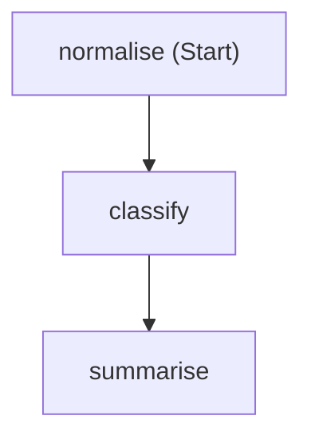
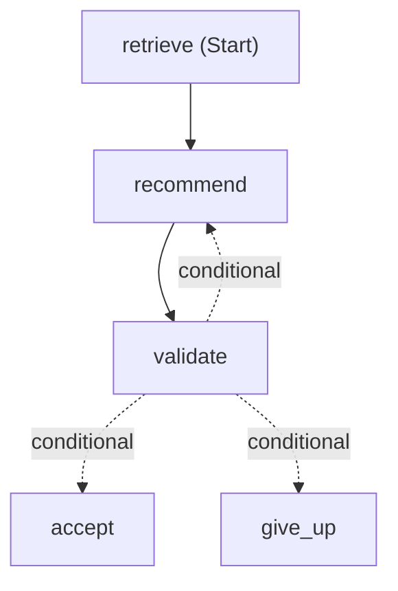

# Module 3 — Workflows

**Time:** 35 minutes.

**Goal:** a running three-agent workflow, and the ability to point at the
lines that make each of its guarantees hold.

Agent Framework gives you three words, and this module is only about them:

| Term | What it is |
| --- | --- |
| **Executor** | A step. It receives input, does work, emits output. |
| **Edge** | A connection that routes a value from one executor to the next. |
| **Workflow** | The graph they form, built with `WorkflowBuilder`. |

That is the whole model. Microsoft Learn covers each in depth —
[workflow concepts](https://learn.microsoft.com/agent-framework/concepts/workflows/),
[executors](https://learn.microsoft.com/agent-framework/concepts/workflows/executors),
and [edges](https://learn.microsoft.com/agent-framework/concepts/workflows/edges)
— and this module builds one, then shows you the same graph running the app.

## Before you start

Sections 5, 9 and 10 change a line and submit a request, so start the app now
and leave it running. `run-backend.ps1` starts the API from
`dotnet/services/api` with `dotnet/services/api/.env` loaded, under
`dotnet watch`, so a saved change rebuilds and restarts it. `run-frontend.ps1`
starts the Vite dev server, which proxies `/api` to the backend. Both block,
so use two terminals.

```powershell
# Terminal 1
.\dotnet\scripts\run-backend.ps1
```

```powershell
# Terminal 2
.\dotnet\scripts\run-frontend.ps1
```

If the backend fails to bind port 8000, it is already running from Module 0 —
keep that terminal and start only the frontend.

Open <http://127.0.0.1:5173>. Section 9 comes back to what a request does once
it arrives.

## 1. The smallest workflow

Run [code/05_first_workflow.cs](code/05_first_workflow.cs). No model, no
Azure, no network — three plain C# steps joined by two edges:

```powershell
dotnet run workshop/dotnet/code/05_first_workflow.cs
```

<!-- sample-05:start -->

<!-- sample-05:end -->

Those three words are the whole model:

- an **executor** is a step — a class deriving from `Executor<TInput, TOutput>`
  that overrides `HandleAsync`, or a plain function turned into one with
  `BindAsExecutor`;
- an **edge** joins two, and the target runs when the source sends a message;
- a **workflow** is `new WorkflowBuilder(start).AddEdge(...).Build()`.

Run [code/06_agents_in_a_workflow.cs](code/06_agents_in_a_workflow.cs), which
swaps two plain steps for agents. That is **sequential orchestration**.

> [!NOTE]
> Sample 6 sets two options on how each agent is hosted in the graph. By
> default Agent Framework for .NET passes one agent's reply to the next as a
> *user* message, and the Foundry Responses API rejects a reply in that role,
> so the sample turns the relabelling off. The comments in the file say which
> option does what.

Now run [code/07_conditional_repair.cs](code/07_conditional_repair.cs), which
adds the one branch this application uses:

<!-- sample-07:start -->

<!-- sample-07:end -->

Both diagrams are generated, not drawn:
[render_workflow_diagram.cs](../../dotnet/scripts/render_workflow_diagram.cs)
builds each workflow and calls `workflow.ToMermaidString()`, and a test fails
if what is committed drifts from what the code produces.

Agent Framework also writes Graphviz DOT (`workflow.ToDotString()`). The app's
graph is committed as `apps/web/public/workflow-graph.svg`, which the app
shows under **Workflow graph** at the foot of the agent panel on the Supports
page, so the picture a learner sees in the running UI comes from the same
`Graph.BuildPlanWorkflow` the request uses. `--dot` prints that graph;
Graphviz turns it into the SVG:

```powershell
dotnet run dotnet/scripts/render_workflow_diagram.cs -- --dot | dot -Tsvg -o apps\web\public\workflow-graph.svg
```

That needs Graphviz installed. The SVG is committed for exactly that reason —
App Service has no `dot`.

The pattern is **sequential orchestration with one conditional repair edge** —
not handoff, concurrent, group chat or magentic.
[docs/orchestration-patterns.md](../../docs/orchestration-patterns.md) covers the
others. The order is fixed; the only branch is the validator's verdict, and
C# decides it, not a model.

## 2. The app is the same graph

Three agents run in order, each needing the previous one's output:

| Agent | Input | Output |
| --- | --- | --- |
| Data Analyst | scores and operations history for one dealership | findings |
| Support Recommender | findings + allowed catalogs + retrieved evidence | a draft plan |
| Validator | the draft + the analyst findings | pass/fail + repair guidance |

The analyst sits between `retrieve` and `recommend`, outside the repair loop:
a rejected draft is the recommender's problem, so re-running the analysis
would cost a model call and change nothing.

Open [dotnet/services/api/AgenticSupportGuide.Api/Workflows/Graph.cs](../../dotnet/services/api/AgenticSupportGuide.Api/Workflows/Graph.cs).
The entire orchestration is one expression:

```csharp
return new WorkflowBuilder(retrieve)
    .WithName("support-plan")
    .WithDescription("Sequential orchestration with one conditional repair edge.")
    .AddEdge(retrieve, analyse)
    .AddEdge(analyse, recommend)
    .AddEdge(recommend, validate)
    .AddEdge<PlanState>(validate, finalise, condition: Plan.Passed)
    .AddEdge<PlanState>(validate, recommend, condition: Plan.NeedsRepair)
    .AddEdge<PlanState>(validate, refuse, condition: Plan.RepairExhausted)
    // Only these two produce the run's result. Naming them keeps a
    // future yield from joining it.
    .WithOutputFrom(finalise, refuse)
    // The working nodes yield their trace rows; these arrive on the
    // event stream as intermediate outputs, never as the result.
    .WithOutputFrom([retrieve, analyse, recommend, validate], OutputTag.Intermediate)
    .WithOpenTelemetry(activitySource: Observability.ActivitySource)
    .Build();
```

Six edges. The three conditional ones are the validator's verdict: pass,
repair once, or give up.

Two details are load-bearing.

**The two `WithOutputFrom` calls.** Every node calls
`context.YieldOutputAsync`, but not for the same reason. The two terminal
nodes yield the run's result; the four working nodes yield one trace row each,
tagged as intermediate. Naming them separately is what keeps a trace row out
of the result: if a later node started yielding, its payload would not quietly
join the result `SingleResult` expects to be exactly one.

**The workflow is built per request, never cached.** A workflow instance
refuses a second concurrent run, and these nodes hold one request's identity.

## 3. The message that travels the edges

An edge routes a value. Here that value is one immutable record, in
[dotnet/services/api/AgenticSupportGuide.Api/Workflows/Plan.cs](../../dotnet/services/api/AgenticSupportGuide.Api/Workflows/Plan.cs):

```csharp
public sealed record PlanState(string Concern)
{
    public EvidenceBundle? Evidence { get; init; }
    public DataAnalystOutput? Analysis { get; init; }
    public SupportRecommendationDraft? Draft { get; init; }
    public ValidatorReport? Report { get; init; }
    public int Attempts { get; init; }
    public int? EvidenceCount { get; init; }
    public int? CitationCount { get; init; }
    public int? CitationsProposed { get; init; }
    public int? CitationsAccepted { get; init; }
    public bool ValidationReached { get; init; }
    public int? DeterministicChecksTotal { get; init; }
    // ...
}
```

Each executor fills in one more property and passes it on with a `with`
expression, which copies the record. The counters at the bottom are the
receipt the UI shows. `null` means the stage never ran; a zero would claim it
ran and found nothing.

> [!IMPORTANT]
> `init`-only properties are not a style preference. A node's outgoing edges
> share **one** message object and each condition is evaluated against it.
> In Agent Framework for Python, an earlier version of this app mutated the
> state in place, the already-scheduled `passed` condition re-read the
> mutated object, saw a clean report, and fired too — one run, two outputs.
> Agent Framework for .NET did not fire the second edge in the same
> experiment, but when a condition reads a shared object is the framework's
> business, not yours; a record that cannot change makes the question moot.
> [SampleWorkflowsTests.cs](../../dotnet/services/api/AgenticSupportGuide.Api.Tests/SampleWorkflowsTests.cs)
> reproduces the experiment and pins today's .NET behaviour, so a framework
> change that alters it is noticed.

The three edge conditions are plain methods in the same file:

```csharp
public static bool Passed(PlanState? state) => state?.Report is { Passed: true };

public static bool NeedsRepair(PlanState? state) =>
    state?.Report is { Passed: false } && state.Attempts < MaxRecommenderAttempts;
```

`RepairExhausted` is the same shape with `>=`. No model decides the route.

Two more properties fall out of the graph shape:

- **Evidence is retrieved by the first executor**, not offered to the analyst
  as a tool it may call. If retrieval returns nothing the run stops with
  `evidence_missing` and no model is invoked at all.
- **No executor checks whether the previous one worked.** A failed step
  throws `StepFailedException` carrying its status and the `PlanState` so far.
  Agent Framework reports it as that executor's failure on the run's event
  stream, so the coordinator handles it in one place. That is why the graph
  reads as six edges and nothing else.

## 4. Inside one executor

Every executor does the same three things around its agent call. `Recommend`
in [dotnet/services/api/AgenticSupportGuide.Api/Workflows/Executors.cs](../../dotnet/services/api/AgenticSupportGuide.Api/Workflows/Executors.cs)
is representative:

```csharp
var result = await Nodes.CallAgentAsync(
    context,
    run,
    plan,
    agentName,
    () => agent.RecommendWithCountsAsync(plan.RequireAnalysis(), recommenderContext, guidance, cancellationToken),
    cancellationToken);
await context.YieldOutputAsync(
    new StepRecord(agentName, "ok", MafAgentRuntime.ProviderId, Nodes.ModelOf(result.Call), TokenEstimate: Nodes.TokensOf(result.Call)),
    cancellationToken);
await context.SendMessageAsync(
    plan with
    {
        Draft = result.Draft,
        Attempts = attempts,
        CitationCount = result.Draft.Citations.Count,
        CitationsProposed = result.CitationsProposed,
        CitationsAccepted = result.CitationsAccepted,
    },
    cancellationToken);
```

The last two counters are why the app can say *"the model proposed three
citation ids and two matched the retrieved bundle"*. The wrapper drops an id
the retriever never returned, so it never reaches the validator and can never
appear as an issue code. Counting it here is the only way to see it.

The three jobs:

1. **Invoke** — `CallAgentAsync` runs the lambda, which is the actual agent
   call.
2. **Typed failure** — `CallAgentAsync` also turns a provider error or bad
   model JSON into a caller-safe status. The mapping is
   `ClassifyProviderError` in
   [Failures.cs](../../dotnet/services/api/AgenticSupportGuide.Api/Workflows/Failures.cs):
   the caller learns which *class* of thing went wrong, never the provider's
   message.
3. **Trace** — `YieldOutputAsync` emits a `StepRecord`: the agent, status,
   the model that actually served the call and the token count, both read
   from Agent Framework's response. That is what the **Agent workflow** panel
   renders.

The row has no duration, because the node does not time itself. The
coordinator in
[Coordinator.cs](../../dotnet/services/api/AgenticSupportGuide.Api/Workflows/Coordinator.cs)
runs the workflow with `InProcessExecution.RunStreamingAsync` and reads Agent
Framework's own events: the trace rows arrive as `WorkflowOutputEvent`s tagged
intermediate, and each node's latency is the gap between its
`ExecutorInvokedEvent` and `ExecutorCompletedEvent`.

You saw all three repair outcomes in sample 7. The **Agent workflow** panel
shows the same thing from a live run: one row per attempt, with the issue
codes that sent the recommender back.

> [!NOTE]
> Telemetry is deliberately absent from that list. Agent Framework
> instruments the graph itself — `invoke_workflow`, `executor.process`,
> `edge_group.process`, and an `invoke_agent` and `chat` span per model call — so a
> hand-written event stream would be a lower-fidelity copy. See
> [Observability.cs](../../dotnet/services/api/AgenticSupportGuide.Api/Observability.cs);
> the whole integration is one tracer provider and the `WithOpenTelemetry` /
> `UseOpenTelemetry` calls on the graph and the agents.

## 5. The contract between agents

Agents hand each other typed objects, not text. Each role's reply is read into
a C# record from
[Contracts.cs](../../dotnet/services/api/AgenticSupportGuide.Api/Agents/Shared/Contracts.cs):
the request asks the model for that shape — the strict JSON schema in the
agent folder's `schemas/output.schema.json` — and the agent validates the
reply against the record before anything else sees it. The next executor
receives the validated object on `PlanState`, never the model's raw text.

A reply that does not parse stops the run at that agent as
`invalid_model_json`. Its issue code is a fixed value,
`AGENT_INVALID_JSON_UNPARSEABLE`, and never the parser's message: a parse
error can quote the offending value, and that value is model output derived
from a dealer group's evidence.

> [!NOTE]
> **"Handoff" here means passing data.** The word "handoff" in the agent
> manifests means *this* — one fixed step passing its output to the next.
> Agent Framework also has a **handoff orchestration**, where an agent
> chooses at runtime which agent to transfer control to. This repo does not
> use that. See
> [docs/orchestration-patterns.md](../../docs/orchestration-patterns.md).

**Try it.** Open `Coordinator_invalid_json_returns_typed_failure` in
[CoordinatorTests.cs](../../dotnet/services/api/AgenticSupportGuide.Api.Tests/CoordinatorTests.cs).
The fake analyst replies `not json`. Make it reply with valid JSON in the
wrong shape instead: replace `invalidJsonFor: "data-analyst-agent"` with
`analystPayload: new() { ["unexpected"] = true }`. Run it from `dotnet`:

```powershell
dotnet test --solution AgenticSupportGuide.slnx --filter-method "*invalid_json*"
```

It still passes. Valid JSON is not enough; the reply has to be the contract's
shape, and a reply that is not stops the run at the agent that produced it —
not with a `NullReferenceException` three methods later. Revert the change
afterwards.

## 6. The checks that decide pass or fail

Open [Checks.cs](../../dotnet/services/api/AgenticSupportGuide.Api/Agents/Validator/Checks.cs).
Every rule is a method with the same signature, registered in one list:

```csharp
public static readonly IReadOnlyList<Action<ValidatorInput, Findings>> DeterministicChecks =
[
    CheckContractVersion,
    CheckDealerGroup,
    CheckCatalogMembership,
    CheckCitations,
    CheckCaveats,
    CheckSupportTier,
    CheckRequiredSections,
    CheckForbiddenDeterminations,
];
```

No check short-circuits the others, so a draft that breaks three rules is
told about all three and one repair round can address everything.

`CheckCitations` is the one to read closely:

```csharp
public static void CheckCitations(ValidatorInput payload, Findings findings)
{
    if (payload.Draft.Citations.Count == 0)
    {
        findings.Flag("MISSING_CITATIONS", "citations");
        return;
    }

    var allowed = payload.Context.AllowedCitationIds.ToHashSet();
    foreach (var citation in payload.Draft.Citations)
    {
        if (citation.DealerGroupId != payload.Context.DealerGroupId)
        {
            findings.Flag("CROSS_DEALER_GROUP_CITATION", "citations");
        }
        if (!allowed.Contains(citation.CitationId))
        {
            findings.Flag("UNKNOWN_CITATION_ID", "citations");
        }
    }
}
```

A GROUP-B citation on a GROUP-A request is a set membership test, not a
prompt instruction. `AllowedCitationIds` came from the retriever, which was
already scoped to the requesting group.

**Try it.** Comment out the body of `CheckCitations` — select the lines
inside its braces and press **Ctrl+/** (a bare `return;` at the top would not
build, because this repo treats the unreachable-code warning as an error).
Run a request. Nothing errors, the plan still looks right, and the guarantee
is gone. Now run `dotnet test --solution AgenticSupportGuide.slnx` from
`dotnet` *with the check still disabled* and read which tests fail — those
tests are the guarantee, written down. Restore the check and confirm they
pass again.

To add a rule: write a method, add it to the list, then add the matching
entry to `RepairTemplates` in
[Repair.cs](../../dotnet/services/api/AgenticSupportGuide.Api/Agents/Validator/Repair.cs),
which tells the recommender how to fix it. That pairing is enforced — a test
reads `Checks.cs` and fails if any code you can emit has no template.

## 7. The repair bound

There is no repair *method*. The bound is the edge condition you already
read in section 3: `NeedsRepair` requires
`state.Attempts < MaxRecommenderAttempts`, which is 2. When it is
exhausted, `RepairExhausted` routes to `Refuse` instead, returning
`VALIDATION_FAILED_AFTER_REPAIR`. The back edge from `validate` to
`recommend` is a real cycle in the graph, but a bounded one: at most one
repair, then a typed refusal.

Two details worth copying:

- The repair pass is traced under its own name,
  `support-recommendation-agent:repair`, so you can see it happened.
- The recheck sets `useLlmCritique = plan.Attempts == 1`. The critique is
  advisory and cannot change a verdict, so paying for it twice buys nothing.

The app sets no clock of its own, and the attempt count is the only thing
that ends the cycle: Agent Framework for .NET keeps running a cycle for as
long as its conditions keep firing. Each model call is bounded by the OpenAI
client's network timeout, and the request as a whole by App Service's
230-second front-end limit.

## 8. Publish the other three roles

`publish_prompt_agents.cs --roles-only` reads the three role `agent.md` files,
composes each one's instructions exactly as the running app does, and creates
a new *version* of an agent named `asg-<role>-<your-alias>`.

Dry run first — it prints what it would create and calls nothing:

```powershell
dotnet run dotnet/scripts/publish_prompt_agents.cs -- --suffix <your-alias> --roles-only
```

Add `--apply` to publish. The three role agents then appear in the portal.


> [!WARNING]
> **Use `--roles-only`, not a bare `--apply`.** The publisher builds each
> version from `agent.md` alone, and a bare `--apply` would also republish
> agents you later create or edit in the portal. Anything added in the portal
> — an attached knowledge base above all — is not in that file, so the new
> version comes back with `Knowledge` empty, and traffic follows the newest
> version.

The backend does not call the published agents. `BuildRuntime` in
[dotnet/services/api/AgenticSupportGuide.Api/AppServices.cs](../../dotnet/services/api/AgenticSupportGuide.Api/AppServices.cs)
loads every role from `agent.md` when the app starts, so a prompt edit needs a
backend restart but no publish step. The published agents are the visible,
versioned artifact of the same definition. Keep them in step by re-publishing
after a prompt change and comparing the `instructions_hash` that
`validate_agent_definitions.cs` prints.

## 9. Follow one request through

In the UI you opened at the start, pick a dealership and submit a concern.

The request lands on `PostRecommendation` in
[dotnet/services/api/AgenticSupportGuide.Api/Endpoints.cs](../../dotnet/services/api/AgenticSupportGuide.Api/Endpoints.cs).
It is short, and it shows the division of labour between the HTTP layer and
the coordinator:

```csharp
var coordinator = new AgentCoordinator(runtime, services.EvidenceRetriever, Config.ProviderDisplayConfigured);
var request = CoordinatorRequestFor(payload, dealership, repos);
var started = Stopwatch.GetTimestamp();
var result = await coordinator.RunAsync(request, http.RequestAborted);
```

`CoordinatorRequestFor` resolves the **allowed catalogs** before the workflow
starts:

```csharp
AllowedGoalIds: options.Goals.Where(g => g.CategoryId == payload.Category).Select(g => g.Id).ToList(),
AllowedStrategyIds: options.Strategies.Where(s => s.CategoryId == payload.Category).Select(s => s.Id).ToList());
```

The recommender may only cite IDs this method handed it. The model does not
choose the universe it draws from.

Now read the trace. The UI panel shows a condensed view — the three agents
with provider, model, latency and status. The full trace, including the
evidence-retrieval step and per-step token counts, is in the API response
body.

> [!NOTE]
> **Coming back after Module 6? Where did my knowledge base go?**
> Skip this on a first pass — the fixture retriever is the right default here.
> Which retriever the backend uses depends on `EVIDENCE_SOURCE`, and the
> backend you started at the top of this module is the local one. Module 6's
> Terraform change set
> that variable on App Service, not on your laptop, and `populate-env.ps1`
> does not write it either — so a local run uses `FixtureEvidenceRetriever`
> unless you say otherwise. To run this module against your own knowledge
> base, add both lines to `dotnet/services/api/.env` and restart:
>
> ```
> EVIDENCE_SOURCE=foundry_iq
> FOUNDRY_IQ_KNOWLEDGE_BASE=asg-kb-<your-alias>
> ```
>
> Check rather than assume:
>
> ```powershell
> $api = "http://127.0.0.1:8000"
> (Invoke-RestMethod "$api/api/health/details").evidence_source
> ```
>
> Either works here. Both implementations satisfy the `IEvidenceRetriever`
> interface in
> [dotnet/services/api/AgenticSupportGuide.Api/Evidence/Retrieval.cs](../../dotnet/services/api/AgenticSupportGuide.Api/Evidence/Retrieval.cs),
> so the coordinator and all three agents are identical either way. Fixtures
> stay the default because they are deterministic and run offline.

## 10. Read a failure

Each typed failure is a distinct,
attributable outcome a caller can branch on:

| status | error_code | what happened |
| --- | --- | --- |
| `evidence_missing` | `EVIDENCE_MISSING` | retrieval returned nothing for this group |
| `invalid_model_json` | `AGENT_INVALID_JSON` | a model returned unparseable or off-schema JSON |
| `validation_failed` | `VALIDATION_FAILED_AFTER_REPAIR` | the validator rejected both attempts |
| `provider_timeout` | `AGENT_PROVIDER_TIMEOUT` | the model call timed out |
| `provider_throttling` | `AGENT_PROVIDER_THROTTLING` | out of tokens-per-minute quota |
| `provider_content_filter` | `AGENT_PROVIDER_CONTENT_FILTER` | a guardrail blocked the call |
| `provider_error` | `AGENT_PROVIDER_AUTH_DENIED` | the identity lacks a role |
| `provider_missing` | `AGENT_PROVIDER_MISSING` | no Foundry project is configured |

The provider rows come from `ClassifyProviderError` in
[dotnet/services/api/AgenticSupportGuide.Api/Workflows/Failures.cs](../../dotnet/services/api/AgenticSupportGuide.Api/Workflows/Failures.cs),
which is the single switch mapping a provider exception type to a
caller-visible status. Throttling and a content-filter block are different
problems with different fixes, so they get different codes.

**Produce one.** Stop the backend, blank `AZURE_AI_FOUNDRY_PROJECT_ENDPOINT`
in `dotnet/services/api/.env`, restart, and submit a request. You get
`provider_missing`, no recommendation body, and no stack trace. Put the
endpoint back and restart before continuing.

Nothing about this requires three agents. What produces it is the wrapper:
`ClassifyProviderError` turning an SDK exception into a status, and
`StepFailedException` carrying that status out of the run. A single-agent
service can have the same property, and most do not — they return prose, and
the caller has nothing to branch on.

## Check yourself

- [ ] The three role agents appear in the portal with your suffix.
- [ ] You ran the flow and read a complete trace.
- [ ] You can point at the line that stops a cross-group citation.
- [ ] You produced at least one typed failure on purpose.
- [ ] You checked whether your trace shows a repair pass on every run.

Next: [Module 4 — Prompt agents](module-4-prompt-agents.md)
